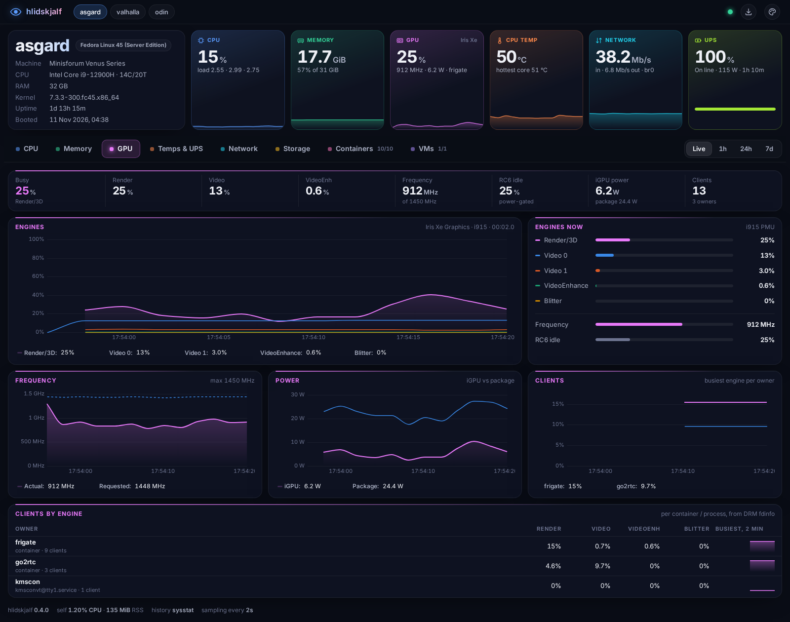
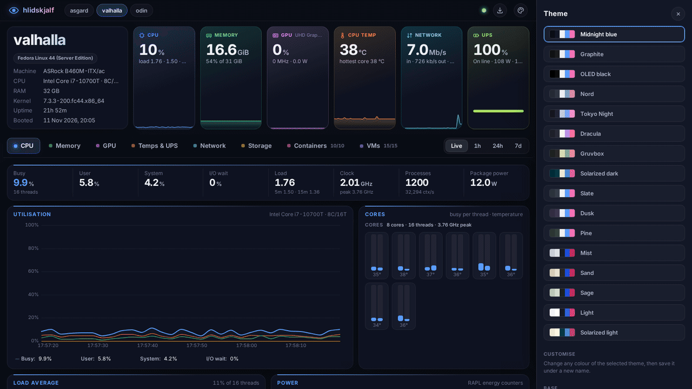

# hlidskjalf

Hliðskjálf is the high-seated throne of the Norse god Odin in Asgard, which lets him see and hear across all nine worlds.

This one watches a Linux server: a read-only dashboard for a single host, with
CPU, memory, GPU, temperatures, UPS, network, storage, podman containers and
libvirt VMs. Each host serves its own page; a switcher in the top bar links them.



More screenshots: [CPU](docs/tab-cpu.png), [Memory](docs/tab-mem.png), [Temps & UPS](docs/tab-temps.png), [Network](docs/tab-net.png), [Storage](docs/tab-disk.png), [Containers](docs/tab-ct.png), [VMs](docs/tab-vm.png), [hardware report](docs/hardware.png), [phone](docs/mobile-gpu.png).

- **Nothing else to run.** Python 3 standard library and vanilla JS. No
  Netdata, Prometheus, database or CDN.
- **Read-only and unprivileged.** No buttons that change anything. The web
  process runs as its own sandboxed user; a small root helper collects the rest.
- **Live and history.** 2-second live samples; 1h / 24h / 7d from sysstat.
- **Extras.** 16 themes plus your own, CSV/JSON export, and a hardware report
  (click the machine tile) you can save as text.



## Install

Needs `python3` 3.9+ and systemd. Optional: `sysstat` (history), `iproute`,
`smartmontools`, `libvirt-client`, rootful `podman.socket`. Anything missing is
reported and its section stays empty.

```sh
git clone https://github.com/mplinuxgeek/hlidskjalf.git && cd hlidskjalf
sudo deploy/install.sh
sudo firewall-cmd --permanent --add-port=8899/tcp && sudo firewall-cmd --reload
```

Open `http://<host>:8899/`. To upgrade, `git pull` and run the installer again.
`deploy/install.sh --help` lists the options, including `--uninstall`.

For history, sysstat must sample every minute:
[setup](docs/reference.md#history-sysstat-at-1-minute-resolution).

## Configure

Edit `/etc/hlidskjalf/hlidskjalf.env`, then `sudo systemctl restart hlidskjalf`.

```sh
HLID_BIND=0.0.0.0
HLID_PORT=8899
HLID_HOSTS=asgard=http://192.0.2.10:8899,valhalla=http://192.0.2.11:8899   # top-bar switcher
HLID_NUT_HOST=192.0.2.10                                                   # UPS via NUT
```

[All settings](docs/reference.md#configuration).

## Security

**There is no authentication.** Anyone who can reach the port sees host
details, IPs, containers, VMs and disks. Bind it to a management address, or to
`127.0.0.1` behind a reverse proxy that adds authentication and TLS. Never
expose it to the internet.

The dashboard never runs as root and cannot reach the podman socket.
[Security model](docs/reference.md#security-model).

## More

[Reference](docs/reference.md): data sources, every setting, security model,
development and the JSON API.

## License

MIT, see [LICENSE](LICENSE). Vendored: uPlot (MIT), Inter and JetBrains Mono
(SIL OFL 1.1); their licenses are in `hlidskjalf/static/vendor/`.
